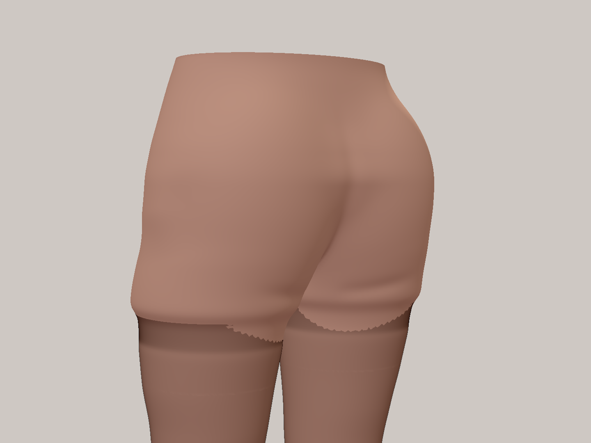
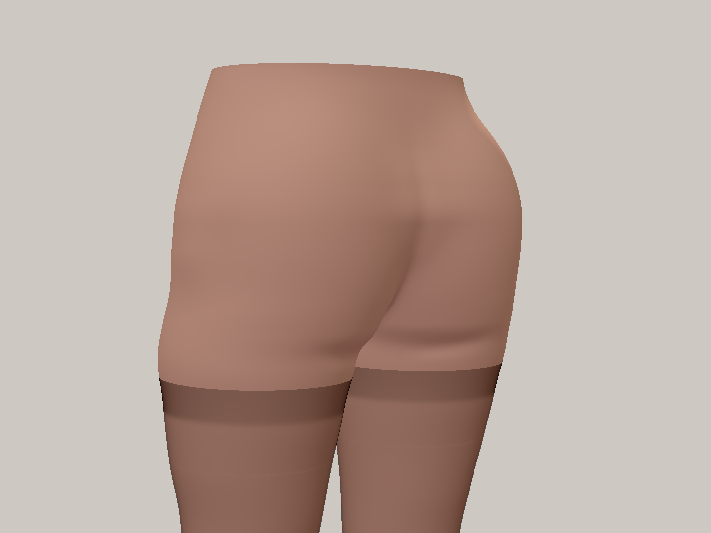

# 段階1a 履き口と臀部下の輪郭の検証

修正前は `0ade436`。いずれも両脚の20D平編みニーハイを、同じカメラ・照明・画面寸法で撮影した。素足表示は同じ背面視点の画像がバイト単位で一致した。[撮影設定](../views-1a-anatomy.json)

| 着用時の観察 | 修正前 | 修正後 |
| --- | --- | --- |
| 後ろ斜め |  |  |
| 側面 | [側面](previous-hip-side-worn.png) | [側面](hip-side-worn.png) |
| 履き口 | [履き口の拡大](previous-cuff-worn.png) | [履き口の拡大](cuff-worn.png) |

[スマホ幅の着用時の後ろ斜め](mobile-rear-worn.png) · [素足の後ろ斜め](hip-rear-bare.png)

| 固定視点 | 修正前 | 修正後 |
| --- | --- | --- |
| 1. 全体 | [正面](../1a-gluteal/01-front.png) | [正面](01-front.png) |
| 2. 斜め | [斜め](../1a-gluteal/02-oblique.png) | [斜め](02-oblique.png) |
| 3. 横シワ | [足首](../1a-gluteal/03a-ankle.png)・[膝裏](../1a-gluteal/03b-knee.png) | [足首](03a-ankle.png)・[膝裏](03b-knee.png) |
| 4. 太ももの拡大 | [太もも](../1a-gluteal/04-thigh.png) | [太もも](04-thigh.png) |
| 5. 極限マクロ | [太もも](../1a-gluteal/05a-thigh-macro.png)・[足首](../1a-gluteal/05b-ankle-macro.png) | [太もも](05a-thigh-macro.png)・[足首](05b-ankle-macro.png) |

## 履き口の計測

同じ高さの水平断面で、布の三角形の重心と辺の中点から、描画された皮膚の三角形までの半径方向の距離を測った。判定対象は片脚の高さ640 mm以上にある布と、履き口の一周。もう一方は鏡映して表示している。背面の膨らみは、布の最高点より上で測った素足との差。圧力とへこみは同じ履き口のサンプルでの静止モデルの推定値。

| 確認項目 | 修正前 | 修正後 |
| --- | ---: | ---: |
| 履き口付近の肌のへこみ | 5.23 mm | 1.45 mm |
| 履き口の接触圧 | 5.04 kPa | 4.79 kPa |
| 履き口より上の背面の最大外向き変位 | 0.38 mm | 0.00 mm |
| 上腿の布と肌の最小距離 | 0.23 mm | 0.31 mm |
| 履き口の一周65点の最小距離 | 0.39 mm | 0.43 mm |
| 測った布の貫通 | 0 / 7,232点 | 0 / 7,232点 |

## 描画・布計算

Linux、Chrome Headless Shell 151.0.7922.34、SwiftShaderのソフトウェアWebGPU、1440 × 1080・DPR 1。全体4.09 FPS、極限マクロ3.27 FPS、WebGPU検証エラー0件。

幅390 pxのモバイル表示で、着用時と素足の切り替えを確認した。今回は iPhone Safari 実機で未計測。マクロの糸幅の中央値は太ももと足首で同じ18 px、固定倍率で約60.6 µmだった。[糸幅の計測](macro-width.json)

| メッシュ | 片脚の計算点 | 片脚の三角形 | 布計算の中央値 | 95%点 |
| --- | ---: | ---: | ---: | ---: |
| 低 | 9,061 | 17,640 | 3.80 ms | 4.50 ms |
| 標準 | 22,945 | 45,120 | 7.10 ms | 10.30 ms |
| 高 | 43,165 | 85,272 | 13.00 ms | 16.80 ms |

[修正前の計測](previous-cuff.json) · [修正後の計測](result.json) · [設計記録](../../docs/decisions/0017-cuff-tissue-transition.md)

撮影と計測は `node checks/1a-cuff/capture.cjs /path/to/chrome-headless-shell /path/to/cdn-cache`、糸幅の確認は `python3 checks/1a/measure-yarn.py checks/1a-cuff` で再実行できる。
