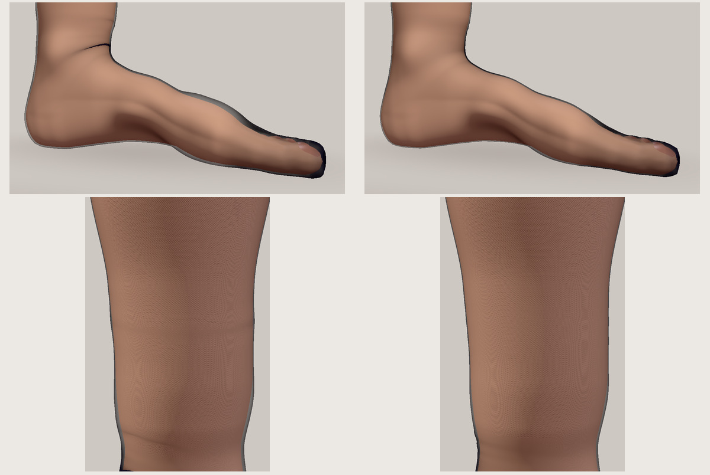

# 段階1a 足部の密着と足首のシワの再検証

既定体型、20D平編み、左右着用。同じカメラと1440 × 1080 pxで比較した。比較元は足部形状改修直後の `95e7c99`。マクロの画像は糸の幅を測れるようにPNGで保存した。

| 固定視点 | 修正前 | 修正後 |
| --- | --- | --- |
| 全体正面 | [前](../1a-foot-detail/01-front.png) | [後](01-front.jpg) |
| 斜め | [前](../1a-foot-detail/02-oblique.png) | [後](02-oblique.jpg) |
| 足首・膝裏 | [足首](../1a-foot-detail/03a-ankle.png) · [膝裏](../1a-foot-detail/03b-knee.png) | [足首](03a-ankle.jpg) · [膝裏](03b-knee.jpg) |
| 太もも拡大 | [前](../1a-foot-detail/04-thigh.png) | [後](04-thigh.jpg) |
| 極限マクロ | [太もも](../1a-foot-detail/05a-thigh-macro.png) · [足首](../1a-foot-detail/05b-ankle-macro.png) | [太もも](05a-thigh-macro.png) · [足首](05b-ankle-macro.png) |
| 足部内側・指先 | [内側](../1a-foot-detail/worn-medial.png) · [指先](../1a-foot-detail/worn-toes.png) | [内側](worn-medial.jpg) · [指先](worn-toes.jpg) · [同じ角度の素足](bare-medial.jpg) |

## 形状の計測

| 指標 | 修正前 | 修正後 |
| --- | ---: | ---: |
| 前足部の見付け幅。布 − 皮膚 | 4.19 mm | 1.95 mm |
| つま先の最前端。布 − 皮膚 | 1.63 mm | 0.98 mm |
| 甲中央の上下方向の隙間。前後軸の4地点 | 1.72〜5.09 mm | 1.13〜1.38 mm |
| 甲と足首の境で皮膚に対し裏を向いた布の面 | 160 / 2,001 | 0 / 1,860 |
| 足部の肌の内側と判定した布面重心 | 0 / 16,320 | 0 / 16,320 |
| 足首正面の波の高さ。着用面からの離れ量の最大値 − 最小値 | 0.45 mm | 0.15 mm |
| 標準メッシュで検出した足首正面の山の間隔 | 16.9、19.3 mm | 9.6、7.2 mm |

布面重心の判定は皮膚の符号付き形状場で行った。表の甲の隙間は両メッシュを貫く垂直線上で測った。幅の差は、左右両側の余裕を合わせた投影幅で測る。波の高さは接触面を基準にする。糸の見かけの幅は同倍率の太ももと足首でともに18 px。[修正前の計測値](before.json) · [修正後の計測値](result.json) · [マクロの幅](macro-width.json)

## 実行環境

Chromium 151、Linux、SwiftShaderによるソフトウェアWebGPU。全体 5.27 FPS、極限マクロ 3.11 FPS、WebGPU検証エラー0件。布の計算は片脚分を解いて鏡映する。9回の測定は1回のWGSL処理と完了待ちを含み、CPUで行う接触面の組み立てとメッシュ描画は別。以前にiPhoneで30 FPSを確認したときと同じメッシュ点数だが、今回の版はiPhone実機で計測していない。

| 布メッシュ | 計算点 | 三角形 | 中央値 | 95パーセンタイル |
| --- | ---: | ---: | ---: | ---: |
| 軽量 | 9,061 | 17,640 | 4.0 ms | 5.0 ms |
| 標準 | 22,945 | 45,120 | 8.1 ms | 9.3 ms |
| 高精細 | 43,165 | 85,272 | 13.3 ms | 14.7 ms |

足首の体型調整90%と110%でも足部の布面重心の貫通と断面の反転は0件。細かいシワの間隔と高さは、立位の静止フィットの設定値から求めた。足首を曲げたときの変化の検証は、動的に接触を解く段階で行う。

既存のPlaywright環境で `node checks/1a-foot-fit/capture.cjs <Chromiumのパス> <three.jsのキャッシュのパス>` を実行するとPNGと計測結果を生成する。 `python checks/1a/measure-yarn.py checks/1a-foot-fit` でマクロの幅を計測できる。
