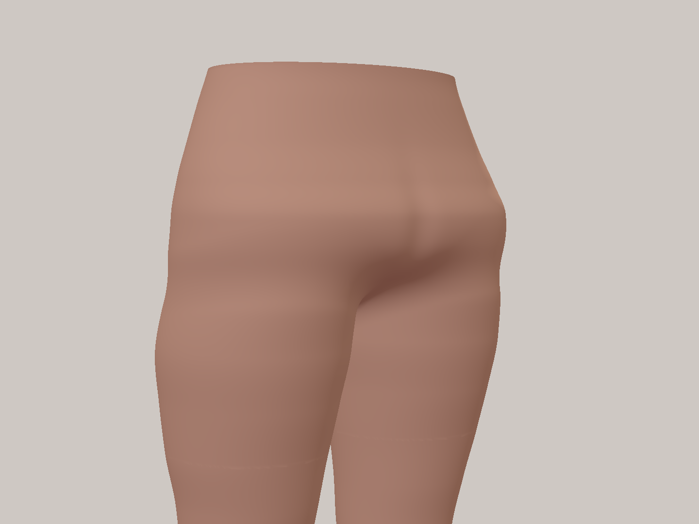
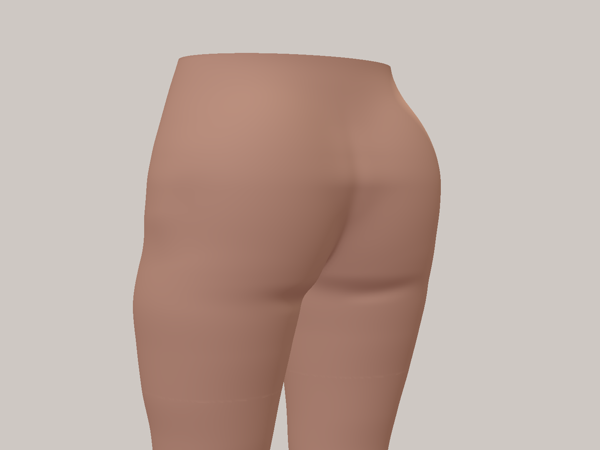
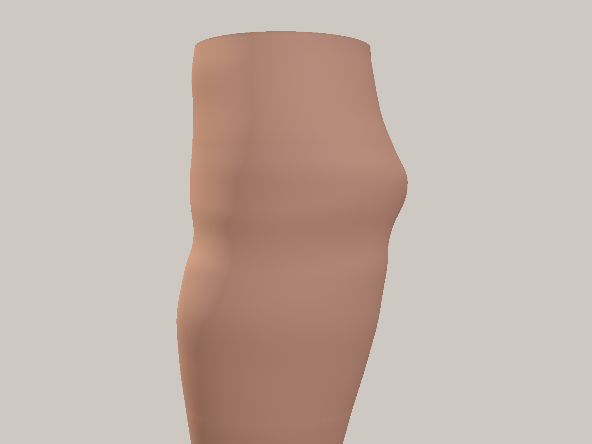
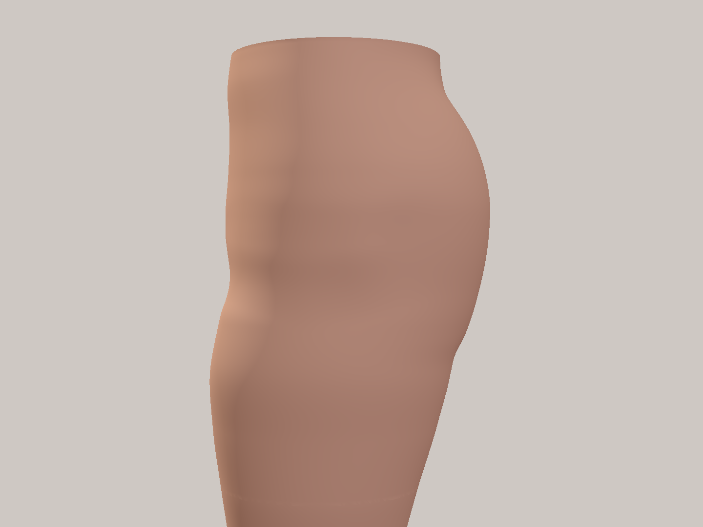

# 段階1a 臀部の曲面の検証

修正前は `fd6f3ed`。すべて同じカメラ設定、照明、画面寸法で比較した。着用写真は両脚の20D平編みニーハイを表示している。[撮影設定](../views-1a-anatomy.json)

| 臀部の観察 | 修正前 | 修正後 |
| --- | --- | --- |
| 後ろ斜め |  |  |
| 側面 |  |  |

[着用時の後ろ斜め](hip-rear-worn.png) · [スマホ幅の後ろ斜め](mobile-hip-rear.png)

| 固定視点 | 修正前 | 修正後 |
| --- | --- | --- |
| 1. 全体 | [正面](../1a-anatomy/01-front.png) | [正面](01-front.png) |
| 2. 斜め | [斜め](../1a-anatomy/02-oblique.png) | [斜め](02-oblique.png) |
| 3. 横シワ | [足首](../1a-anatomy/03a-ankle.png)・[膝裏](../1a-anatomy/03b-knee.png) | [足首](03a-ankle.png)・[膝裏](03b-knee.png) |
| 4. 太ももの拡大 | [太もも](../1a-anatomy/04-thigh.png) | [太もも](04-thigh.png) |
| 5. 極限マクロ | [太もも](../1a-anatomy/05a-thigh-macro.png)・[足首](../1a-anatomy/05b-ankle-macro.png) | [太もも](05a-thigh-macro.png)・[足首](05b-ankle-macro.png) |

## 形状と回帰確認

| 項目 | 採寸資料の平均 | 修正前 | 修正後 |
| --- | ---: | ---: | ---: |
| 殿幅 | 330.7 mm | 330.9 mm | 332.2 mm |
| 殿部厚径 | 207.2 mm | 206.3 mm | 206.4 mm |
| 股下高 | 714.5 mm | 714.6 mm | 711.3 mm |
| 大腿幅 | 163.4 mm | 163.4 mm | 163.5 mm |
| 大腿厚 | 180.7 mm | 180.7 mm | 180.8 mm |

背面メッシュを中心線から45・90・120・135 mmの4断面で切り、モデル座標の高さ715〜840 mmで前後の10 mmずつの傾きを比較した。段差の程度を測るこの範囲では、臀溝の中心を測定対象から外した。4断面の最大角度差は順に18.0°・17.6°・16.8°・17.5°から、14.0°・8.9°・6.4°・8.8°に減った。メッシュは閉じた1成分。境界辺・非多様体辺・面の向きの不整合は各0件。[修正前の輪郭データ](previous-posterior.json) · [修正後の輪郭データ](result.json) · [形状の根拠](../../docs/decisions/0016-gluteal-contour.md)

太ももの不透明度は0.211、足首は0.237で、張力と不透明度の相関係数は−0.314。マクロの糸幅の中央値は両方18 px、固定倍率で約60.6 µm。片足の標準メッシュで足部16,320面の重心がすべて肌の外にあることも確認した。[糸幅の計測](macro-width.json)

## 描画・布計算

Linux、Chrome Headless Shell 151.0.7922.34、SwiftShaderのソフトウェアWebGPU、1440 × 1080・DPR 1。全体6.15 FPS、極限マクロ3.20 FPS、WebGPU検証エラー0件。スマホ幅390 pxのタッチ環境で臀部の2視点と素足の切り替えを確認した。今回の版はiPhone Safariでの実測待ち。

| メッシュ | 片脚の計算点 | 片脚の三角形 | 布計算の中央値 | 95%点 |
| --- | ---: | ---: | ---: | ---: |
| 低 | 9,061 | 17,640 | 4.10 ms | 6.00 ms |
| 標準 | 22,945 | 45,120 | 8.10 ms | 12.30 ms |
| 高 | 43,165 | 85,272 | 12.10 ms | 14.50 ms |

撮影と測定は `node checks/1a-gluteal/capture.cjs /path/to/chrome-headless-shell /path/to/cdn-cache`、糸幅の検証は `python3 checks/1a/measure-yarn.py checks/1a-gluteal` で再実行できる。
