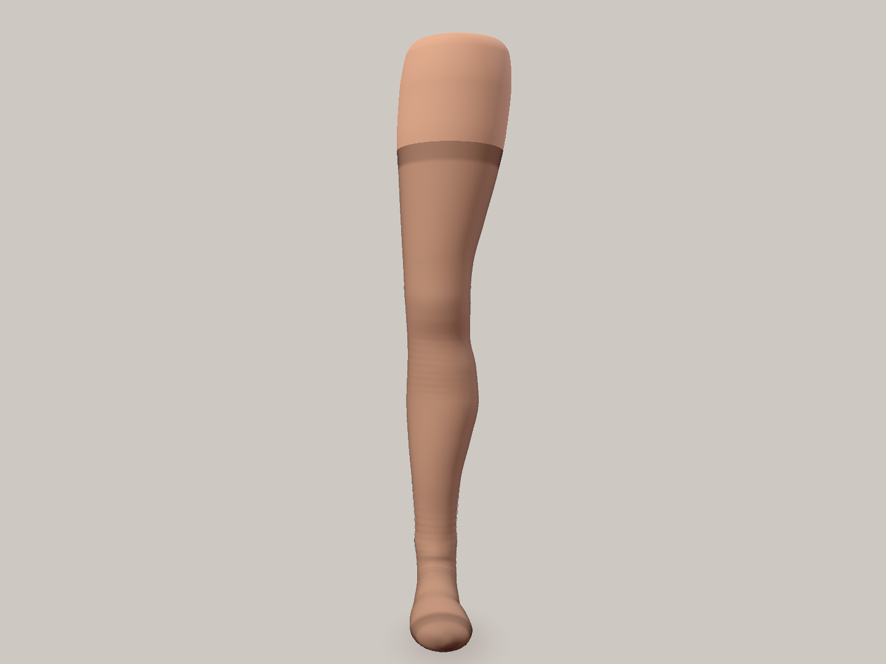

# 段階1aの検証

20D平編みニーハイ1種類を片脚に着用した固定状態。撮影条件は [views-1a.json](../views-1a.json) の 1440 × 1080、DPR 1。段階0では三角形のみを表示していたため、脚の五視点は段階1aを比較の初回とする。

| 視点 | 段階0 | 段階1a |
| --- | --- | --- |
| 1. 全体 | [三角形の描画診断](../0/webgpu-probe.png) |  |
| 2. 斜め | 三角形の診断 | [斜め](02-oblique.png) |
| 3. シワ | 三角形の診断 | [足首](03a-ankle.png)・[膝裏](03b-knee.png) |
| 4. 太ももの拡大 | 三角形の診断 | [太もも](04-thigh.png) |
| 5. 極限マクロ | 三角形の診断 | [太もも](05a-thigh-macro.png)・[足首](05b-ankle-macro.png) |

確かめ用の表示は [張力](diagnostic-tension.png)、[周方向の伸び](diagnostic-stretch.png)、[不透明度](diagnostic-opacity.png)。公開ページの「確かめる」から隙間・接触圧・乾燥状態にも切り替えられる。

## 物理量と光学

| 部位 | 周方向伸長率 | 周方向張力 | 正対時の不透明度 |
| --- | ---: | ---: | ---: |
| 太もも | 2.71 倍 | 135.5 N/m | 22.4% |
| 足首 | 1.28 倍 | 6.4 N/m | 27.3% |
| トップバンド | 3.16 倍 | 384.1 N/m | 40.4% |
| つま先補強 | 2.07 倍 | 57.1 N/m | 44.2% |

不透明度は WGSL と同じ遠景式を正対条件で評価した値。張力は材料設定に基づく推定値。足部と補強域を除く 16,315 点で、周方向張力と不透明度のピアソン相関は −0.57。補強や角度の影響で全体が単調対応するわけではない。

採取範囲内での隙間は足首で 0.50〜2.29 mm、膝裏で 0.45〜2.30 mm。横シワの輪郭と色の周期を撮影で確認した。完全な折り重なりを扱うには後段の自己接触が必要。

同倍率のマクロ PNG の画素幅から換算した糸径は太もも 60.6 µm、足首 60.2 µm（中央値、差 0.6%）。シェーダーに渡す実寸糸径は共通で 59.55 µm。換算値は像の中心付近における近似。各マクロに 1 mm のスケールを入れた。[画像からの測定](macro-width.json)

## 性能

Linux x64、Chrome Headless Shell 151.0.7922.34、SwiftShader。実行時の CDN 応答はバイト一致を確認済みのキャッシュを使用。描画の計測は 12 フレームのウォームアップ後の rAF 90 間隔、布の計測はパイプライン準備後、2パスを送信して完了を待つ時間を15回計測した。CPU 上の入力準備、バッファの読み戻し、描画は布の1回の計算時間から外した。継ぎ目の複製点を「計算点」に含める。つま先の描画用中心点はこの列の外に1点。

| 設定 | 計算点 | 三角形 | 2パス中央値 | 2パス95%点 | CPU入力準備 |
| --- | ---: | ---: | ---: | ---: | ---: |
| 低解像度 | 9,061 | 17,640 | 2.30 ms | 2.50 ms | 61.3 ms |
| 標準 | 22,945 | 45,120 | 2.40 ms | 2.70 ms | 116.1 ms |
| 高解像度 | 43,165 | 85,272 | 3.60 ms | 4.20 ms | 177.5 ms |

| 描画 | FPS | フレーム時間95%点 |
| --- | ---: | ---: |
| 全体 | 11.77 | 100.0 ms |
| 太ももの極限マクロ | 5.30 | 200.1 ms |

Chrome Headless Shell での WebGPU 検証エラーは 0 件。モバイル表示の Chromium エミュレーションで横スクロールが発生せず、マクロの切替、設定シートの閉じるボタン、シートを閉じた後の診断表示を確認した。

別の確認として、390 × 844・DPR 1 の Chromium モバイル表示で、公開ページと同じUIの計測ボタンを実行した。低・標準・高の全体 FPS は順に 37.5、27.3、26.2。標準の極限マクロは 23.9 FPS。いずれも SwiftShader で、Safari 実機の値ではない。

### iPhone Safari 実機

ユーザーが iPhone 18 Pro・iOS 27.3 の Safari で、公開版 `62c32f8` の計測結果を確認した。画面に表示された標準メッシュの全体・極限マクロはどちらも 30.0 FPS。

| メッシュ | 計算点 | 三角形 | 布計算1回の中央値 | 布計算95%点 | 全体 |
| --- | ---: | ---: | ---: | ---: | ---: |
| 低 | 9,061 | 17,640 | 1.00 ms | 1.00 ms | 30.0 FPS |
| 標準 | 22,945 | 45,120 | 1.00 ms | 1.00 ms | 30.0 FPS |
| 高 | 43,165 | 85,272 | 1.00 ms | 1.00 ms | 30.0 FPS |

計測画面の表示値で、全体30 FPSの目標を3種類とも達成した。今回30.0 FPSを確認した最大は 43,165 計算点・85,272 三角形。実機の描画余力と、それを超える解像度の性能は未計測。[メッシュの採用判断](../../docs/decisions/0008-stage1a-fit-and-mesh-budget.md)

計測の詳細は [result.json](result.json)。再現にはリポジトリルートから `node checks/1a/capture.cjs /path/to/chrome-headless-shell /path/to/cdn-cache` を実行する。キャッシュの内容は [段階0](../0/README.md) と同じ。PNG の糸幅比較は NumPy、Pillow、SciPy がある Python で `python3 checks/1a/measure-yarn.py` を実行する。
