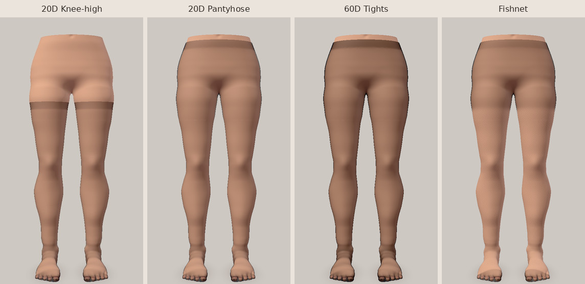

# 段階1b 腰丈の3種類の検証

同じ既定体型、照明、カメラ、1440 × 1080 pxで撮影した。各写真は左から前回の20Dニーハイ、20Dパンスト、60Dタイツ、網タイツ。4列とも同じ範囲を切り出している。

| 固定視点 | 写真 |
| --- | --- |
| 全体正面 | [4種類](01-front.jpg) |
| 斜め | [4種類](02-oblique.jpg) |
| 足首と膝裏 | [足首](03a-ankle.jpg) · [膝裏](03b-knee.jpg) |
| 太ももの拡大 | [4種類](04-thigh.jpg) |
| 極限マクロ | [太もも](05a-thigh-macro.jpg) · [足首](05b-ankle-macro.jpg) |

## フィットと編み目

| プリセット | 太もも／足首の正面不透明度 | 糸の見かけの幅 太もも／足首 | 着用面の三角形 |
| --- | ---: | ---: | ---: |
| 20Dパンスト | 20.9%／23.4% | 18.00／18.00 px | 157,726 |
| 60Dタイツ | 33.5%／37.7% | 30.46／30.46 px | 157,726 |
| 網タイツ | 8.6%／10.7% | 66.21／66.48 px | 157,730 |

不透明度は布の伸びから求めた正面方向の平均被覆のモデル値。3種類とも足首より太ももが透けやすく、つま先補強の不透明度は足首より高かった。糸幅は同倍率の画像上で推定した。網の糸束での幅の差は約0.4%。

3種類とも、同位置のUV境界頂点を合わせたときに布は一つにつながり、ウエストだけが開いていた。標準メッシュの重心検査では、足部と骨盤部の肌の内側に入った点は0件。網タイツでヒップと太ももを110%に変えた場合も同じ結果だった。モバイル幅でのプリセット切り替えと、ニーハイへ戻したあとの着脱ボタンを確認した。[390 px幅の画面](mobile.jpg) · [画像の糸幅計測](macro-width.json) · [計測の詳細](result.json)

## 速度

Chromium 151、Linux、SwiftShader。WebGPU検証エラーとブラウザーのエラーは0件。iPhone Safari実機の30 FPS条件は未確認。

| プリセット | 全体 FPS | 極限マクロ FPS | 標準メッシュの布計算 中央値／95%点 |
| --- | ---: | ---: | ---: |
| 20Dパンスト | 4.25 | 2.76 | 6.6／7.6 ms |
| 60Dタイツ | 5.21 | 3.18 | 6.9／7.5 ms |
| 網タイツ | 5.02 | 3.33 | 6.3／7.3 ms |

布計算は左右対称の片脚で計測した。軽量は9,061点／17,640面、標準は22,945点／45,120面、高精細は43,165点／85,272面。3種類を通じた中央値はそれぞれ3.6〜3.7 ms、6.3〜6.9 ms、11.4〜11.8 ms。骨盤部の静止シェルは別に生成する。左右の脚と骨盤の布を合わせた描画面数はフィットの表に記載した。

## 再現

既存のPlaywright環境で `node checks/1b/capture.cjs <Chromiumのパス> <three.jsのキャッシュのパス> <撮影先>` を実行する。固定ビューの比較と糸幅を生成するには、同じ撮影先を `python checks/1b/compare.py <撮影先>` に渡す。
