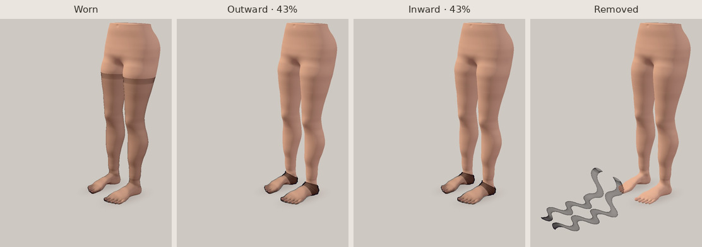

# 段階2 斜めの着脱と連続接触の検証

20D平編みニーハイ、既定体型、左右対称。着脱経路の写真と固定視点は Chromium 151、Linux、SwiftShader の WebGPU、1440 × 1080 px。操作の録画の代わりに、進行位置を固定して前・途中・後を撮影した。

左から着用中、外側へ斜め、内側へ斜め、脱衣後。斜めの二枚はともに着用位置43%。[モバイル幅の画面](mobile.jpg)

## 固定した五視点

| 視点 | 前回 | 今回 |
| --- | --- | --- |
| 全体正面 | [前](../2/01-front.jpg) | [後](01-front.jpg) |
| 斜め | [前](../2/02-oblique.jpg) | [後](02-oblique.jpg) |
| 足首と膝裏 | [足首](../2/03a-ankle.jpg) · [膝裏](../2/03b-knee.jpg) | [足首](03a-ankle.jpg) · [膝裏](03b-knee.jpg) |
| 太もも拡大 | [前](../2/04-thigh.jpg) | [後](04-thigh.jpg) |
| 極限マクロ | [太もも](../2/05a-thigh-macro.png) · [足首](../2/05b-ankle-macro.png) | [太もも](05a-thigh-macro.jpg) · [足首](05b-ankle-macro.jpg) |

## 検査結果

- 途中の時間だけで発生する面の交差、同一平面の辺の交差、近いが離れたまま移動する例、縫い目のUV重複を検査した。合成テスト4件が通過した。
- 390 × 844 pxのタッチ画面で、「速く引く」を選んだ。外側へ斜めにずり下ろし、内側に切り替えて履き戻し、途中で停止した。そこから引き抜き、まっすぐに切り替えて再着用まで到達した。219区間を採用した。肌に対して交差を検出した102候補は、移動を短くして再検査した。この再生中に、布面の交差の可能性だけを理由に棄却した候補は0件。
- 外側・内側の斜めを含む8姿勢で、足部の布面重心229,440点のうち肌の内側と判定した点は0。非隣接の布面の辺が別の面を貫く交差は0件。
- WebGPU検証エラーは0件。固定表示は全体4.45 FPS、極限マクロ3.14 FPS。モバイル幅の更新速度は、外側のずり下ろし2.75、内側に切り替えた後の引き抜き6.16、まっすぐ再着用5.47更新/秒。引き抜きには脱衣後の垂れが落ち着くまでを含む。
- 片脚22,945点、45,120三角形。連続判定を加えた着脱中のiPhone Safari実機は未計測。

肌との判定は布頂点と人体面を対象とする。布面どうしは頂点を共有しない面が対象。左右は中央面を越えないようにする。引く向きは着脱の経路に沿って履き口を傾ける操作。自由な把持と腰丈プリセットの着脱は今後の検証課題。[判定の設計](../../docs/decisions/0025-continuous-cloth-contact.md) · [計測値](result.json)

`node --test checks/2/*test.cjs` と、既存のPlaywright環境で `node checks/2-contact/capture.cjs <Chromiumのパス> <three.jsのキャッシュのパス>` を実行して再現できる。
