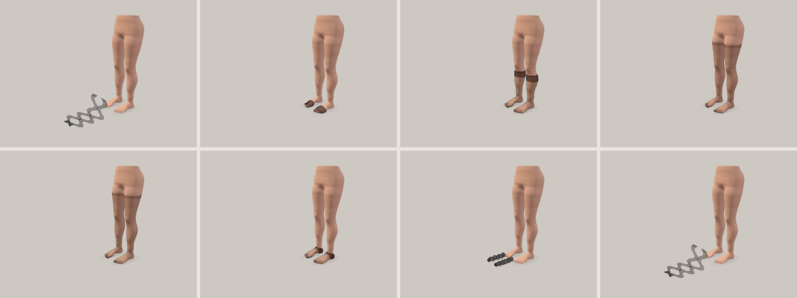

# 段階2 着脱の初期検証

[布面どうしの連続判定と斜めの着脱の検証](../2-contact/README.md)

既定体型、20D平編みニーハイ、左右対称の着脱。自動撮影には Chromium 151 と Linux 上の SwiftShader を使用した。全体とマクロの固定写真は1440 × 1080 px。モバイルの操作確認は同じ環境を390 × 844 pxのタッチ表示に設定した。

## 固定した五視点

| 視点 | 段階1aの足部修正後 | 段階2 |
| --- | --- | --- |
| 全体正面 | [前](../1a-foot-fit/01-front.jpg) | [後](01-front.jpg) |
| 斜め | [前](../1a-foot-fit/02-oblique.jpg) | [後](02-oblique.jpg) |
| 足首と膝裏 | [足首](../1a-foot-fit/03a-ankle.jpg) · [膝裏](../1a-foot-fit/03b-knee.jpg) | [足首](03a-ankle.jpg) · [膝裏](03b-knee.jpg) |
| 太もも拡大 | [前](../1a-foot-fit/04-thigh.jpg) | [後](04-thigh.jpg) |
| 極限マクロ | [太もも](../1a-foot-fit/05a-thigh-macro.png) · [足首](../1a-foot-fit/05b-ankle-macro.png) | [太もも](05a-thigh-macro.png) · [足首](05b-ankle-macro.png) |

## 動作の前・中・後

- 履く順序は [脱衣後](before.jpg) → [足先](toes.jpg) → [ふくらはぎ](calf.jpg) → [着用](worn.jpg)。
- 脱ぐ順序は [着用](worn.jpg) → [かかと](heel.jpg) → [引き抜く途中](pull-free.jpg) → [引き抜いた直後](released.jpg) → [重力で垂れた布](folded.jpg)。
- スマートフォン幅で [素脚と脱衣後の布の比較](mobile-comparison.jpg) と [布だけの表示](mobile-cloth.jpg) を撮影。素脚のみは画面操作で確認。

## 計測

- 19姿勢で足部の布面重心を計406,784点検査し、肌の内側と判定した点は0。非隣接の布三角形の内側を辺が通過する交差も、19姿勢で0件。
- 「ずり下ろす」から「履く」へ切り替え、途中で停止して引き抜いた。その後、脱衣後の布を表示し、再着用まで操作した。肌の連続判定で交差した候補は、短い移動にやり直してから表示した。
- 検証エラーはデスクトップ幅・モバイル幅とも0件。計算する布は片脚で22,945点、45,120三角形。左右は鏡映。
- 固定表示は全体6.02 FPS、極限マクロ3.62 FPS。モバイル幅での着脱中の計算・表示更新はずり下ろし6.02、引き抜き10.49、再着用10.09更新/秒。iPhone Safari実機は未測定。

動作中の連続判定は布頂点と人体面の組み合わせ。布どうしの検査結果は、検査した離散姿勢についての記録であり、任意の動きや時間区間の保証はできない。布の縁を任意方向に引く動作と、面どうしの連続判定は未実装。[設計と検出の範囲](../../docs/decisions/0022-guided-dressing-contact.md) · [計測値](result.json)

既存のPlaywright環境で `node checks/2/capture.cjs <Chromiumのパス> <three.jsのキャッシュのパス>` を実行すると比較写真と計測値を生成する。線分による衝突判定は `node --test checks/2/swept-vertices.test.cjs` で確認できる。
